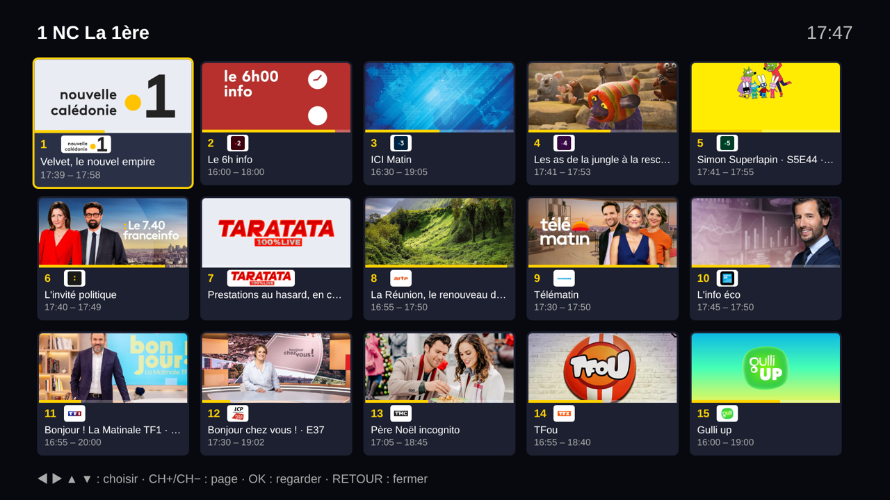

# NC TV — direct NC La 1ère sur TV Samsung (Tizen)

Une application Tizen qui ouvre directement le direct de **NC La 1ère** en plein écran,
sans passer par le site web, avec quelques chaînes France TV et une chaîne Taratata en plus.



## Chaînes

| N° | Chaîne | État |
|---|---|---|
| 1 | NC La 1ère | ✅ |
| 2 à 5 | France 2, 3, 4, 5 | ✅ |
| 6 | franceinfo | ✅ |
| 7 | Taratata (prestations au hasard, en continu) | ✅ |
| 8 | Arte | ✅ |
| 9 | TV5 Monde | ✅ |
| 10 | France 24 | ✅ |
| 11 et + | Chaînes ParaTV : TF1, LCP, TMC, TFX, Gulli, BFM TV, CNews, LCI, CStar (son un peu long à venir), T18, NOVO19, TF1 Séries Films, L'Équipe, Sport en France, Le Figaro TV, Canal+ en clair, Public Sénat, Europe 1 TV… | ✅ |

(État vérifié depuis la Calédonie. RMC Story, RMC Découverte et Canal 32 ne marchent pas
depuis la Calédonie et sont retirés via `PARATV_SKIP`.)

## Mosaïque

Touche **OK** : mosaïque de toutes les chaînes, 5 par ligne. Chaque case montre l'image du
programme en cours, le logo, le titre, les horaires et une barre de progression (mis à jour
toutes les 30 s). La chaîne en cours continue derrière.
◀ ▶ ▲ ▼ pour choisir, CH+/CH− pour changer de page, OK pour regarder, RETOUR pour fermer.

Une vraie mosaïque vidéo façon Free n'est pas possible sur la TV : elle ne décode qu'un ou
deux flux à la fois (chez Free, la mosaïque est une seule vidéo préparée sur leurs serveurs).
Les images viennent du guide SFR (NC La 1ère et Taratata affichent leur logo).

## Programme en cours

Le bandeau (au changement de chaîne, ou avec INFO) affiche l'émission en cours,
ses horaires **à l'heure de la TV** et, si dispo, saison/épisode et titre de l'épisode :
- **NC La 1ère** : page « direct TV » de la1ere.franceinfo.fr (rafraîchie toutes les 5 min) ;
- **les autres chaînes** : guide des programmes public de SFR TV (un fichier par jour,
  ~1,4 Mo, chargé une fois puis gardé en mémoire). L'identifiant SFR de chaque chaîne est
  dans `epg: { sfr: '…' }` (`js/channels.js`) ou dans l'attribut `epg-s` de la playlist ParaTV ;
- **Taratata** : artiste et titre de la prestation.

Pas de programme pour NOVO19, Sport en France, Public Sénat, LCP-Public Sénat et Europe 1 TV
(pas d'identifiant SFR dans ParaTV).

**Chaînes 1 à 10** : définies dans `CHANNEL_LIST` (`js/channels.js`), une ligne `{ name, urls }`
par chaîne France TV « simulcast ». Pour en retirer une, supprimer sa ligne.

**Chaîne Taratata** : choisit une émission au hasard, puis une prestation (sans les
interviews), affiche l'artiste et le titre, et prépare la suivante pendant la lecture. Les
vidéos sont hébergées par mytaratata.com sur `media.grandprix.tv` (malgré le nom, c'est bien
leur hébergeur vidéo), avec le MP4 de `videos.mytaratata.com` en secours.

**Chaînes ParaTV (11 et +)** : au démarrage, l'app télécharge la playlist « France » du
projet communautaire [ParaTV](https://github.com/Paradise-91/ParaTV), qui régénère plusieurs
fois par jour des liens signés (ceux de TF1 durent ~4 h). À chaque lancement d'une chaîne,
l'app relit le fichier ParaTV pour avoir le lien le plus récent ; si une chaîne a plusieurs
sources (ex. CNews via Canal+ ou Dailymotion), elle prend la première qui répond. Les chaînes
déjà présentes plus haut sont ignorées. Pour en retirer d'autres, ajouter leur nom simplifié
(minuscules, sans accents ni espaces, ex. `tfx`, `cstar`) dans `PARATV_SKIP` (`js/paratv.js`).
⚠️ Ça dépend de ParaTV : si le projet s'arrête ou change sa playlist, ces chaînes tombent.

## Comment ça marche

1. L'app demande au service de jeton de France TV (`hdfauth.ftven.fr/esi/TA`) de signer
   l'URL du flux (même principe que catchuptvandmore).
2. Elle essaie d'abord les variantes **locales** du flux (réservées au territoire),
   puis la variante **« monde »** (`hls_monde_1er_NC`, testée et fonctionnelle) en secours.
3. Le flux HLS (jusqu'en 1080p, chiffré AES-128 avec une clé publique) est lu par le
   lecteur natif Samsung (AVPlay).
4. Le jeton dure environ 6 h : l'app relance le flux toutes les 5 h. En cas de coupure,
   elle réessaie toute seule (3 s, 6 s, 12 s… jusqu'à 60 s).

## Télécommande

| Touche | Action |
|---|---|
| CH+ / CH− / ◀ ▶ ▲ ▼ | Chaîne suivante/précédente |
| 0 à 9 | Aller directement à la chaîne n° (1 ou 2 chiffres, ex. 1 puis 1 → chaîne 11) |
| ⏩ / ▶❚❚ | Taratata : passer à la prestation suivante |
| OK | Ouvre la mosaïque des chaînes |
| INFO | Affiche la chaîne et le programme en cours |
| RETOUR / EXIT | Quitter |

## Tester depuis ton PC

```
python3 tools/test_stream.py
```
Ce script teste chaque chaîne de `js/channels.js` et de la playlist ParaTV depuis chez toi (`[OK ]` / `[NON]`) et
donne une URL à coller dans VLC. Si une version locale de NC La 1ère répond `[OK ]`, l'app
l'utilisera automatiquement.

## Installer sur la TV avec Apps2Samsung (recommandé)

[Apps2Samsung](https://github.com/Apps2Samsung/Apps2Samsung) crée le certificat et signe
l'application tout seul : il suffit de lui donner le fichier `.wgt` **non signé**.

### 1. Récupérer le fichier `.wgt`

Le plus simple : télécharger **NC-TV.wgt** dans la dernière
[release](https://github.com/kvernNC/nc-tv-tizen/releases/latest).

Ou le fabriquer soi-même :

```
python3 tools/build_wgt.py
```
→ crée `dist/NC-TV.wgt` (une simple archive des fichiers de l'app). Le relancer après
chaque modification du code.

### 2. Mode développeur sur la TV (déjà fait si Moonlight est installé)

1. Bouton **Home** → **Apps**.
2. Taper **12345** à la télécommande (ou sur le clavier à l'écran).
3. Passer **Developer mode** sur **ON** et saisir l'**adresse IP locale du PC**
   (Windows : `ipconfig` → « Adresse IPv4 » ; Linux/Mac : `ip addr` / `ifconfig`).
4. Redémarrer la TV. Si le PC ne la trouve pas ensuite : débrancher la TV 15 s puis rebrancher.

PC et TV doivent être sur le même réseau. Si l'IP du PC a changé depuis l'installation de
Moonlight, mets à jour l'IP dans le mode développeur.

### 3. Installer

1. Lancer Apps2Samsung sur le PC ; il détecte la TV.
2. Au lieu d'une app du catalogue, **choisir ton propre fichier `.wgt`** →
   sélectionner `dist/NC-TV.wgt`.
3. Choisir la TV, puis **Install**. Apps2Samsung réutilise le certificat (et la connexion
   au compte Samsung) déjà utilisés pour Moonlight.
4. « NC TV » apparaît dans **Apps** sur la TV.

Variante en ligne de commande (sans interface) :
```
apps2samsung-cli sign dist/NC-TV.wgt -o dist/NC-TV-signed.wgt --tv <IP_TV>
```
(signe seulement ; à installer ensuite avec `tizen install` ou `sdb`.)

### Mettre à jour l'app

Refaire `python3 tools/build_wgt.py`, puis réinstaller avec Apps2Samsung **sur le même PC**
(même certificat). Si la TV refuse la mise à jour pour cause de certificat différent,
désinstaller « NC TV » sur la TV puis réinstaller.

## Installer avec Tizen Studio / CLI (alternative)

Avec un profil de certificat Samsung existant :

```
tizen build-web -- .
tizen package -t wgt -s <ton_profil_certificat> -- .buildResult
sdb connect <IP_TV>
tizen install -n "NC TV.wgt" -- .buildResult
```

## Publier une nouvelle version

Changer le numéro dans `config.xml` (`version="1.0.1"`), commiter et pousser sur `main` :
GitHub fabrique le `.wgt` et publie la release `v1.0.1` automatiquement
(`.github/workflows/release.yml`). Un push sans changement de version ne publie rien.
